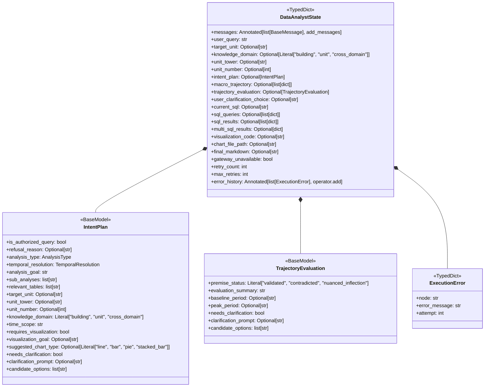

# Building Analytics Engine — Engineering & Developer Architecture Specification

This document provides a comprehensive technical reference for the analytics engine located at [`backend/app/agent/analytics/`](file:///home/nereyes/agentes/data-analyst-ai-agent/backend/app/agent/analytics). It details the state machine mechanics, typed contracts, conditional edge routers, isolation boundaries, error recovery circuits, and observability instrumentation.

---

## 1. Executive Summary & Core Invariants

The analytics subsystem is an autonomous, stateful **LangGraph** workflow (`ExpenseAnalyticsGraph`) engineered to answer complex financial questions regarding Chilean condominium building expenses (*Gastos Comunes*). The engine supports two distinct analytical planes:
1. **Building-Wide Macro Analytics**: Operating across building expense reports (`expense_reports`), expense sections (`expense_sections`), and line-item details (`expense_items`).
2. **Individual Unit Analytics**: Operating across resident apartment bills (`unit_bills`), billing concepts (`unit_bill_concepts`), water consumption logs (`unit_bill_consumptions`), and individual charges/fines (`unit_bill_charges`).

### Core Engineering Invariants
* **2-Hop Causal Reasoning**: Queries seeking root causes of cost changes (e.g., *"¿Por qué subió el gasto común?"*) are never answered with single static sums. The engine executes a macro trajectory inspection (Hop 1) to validate the premise and isolate chronological inflection periods before executing fine-grained micro-attribution queries (Hop 2).
* **Strict Read-Only In-Process Security**: All dynamic SQL queries pass through an AST and regex security gateway (`gateway_client.py`) that strictly permits single `SELECT` or `WITH ... SELECT` queries against an explicit table whitelist (`ALLOWED_TABLES`), blocking schema inspection catalogs, pragmas, and all mutation primitives.
* **Subprocess Script Isolation**: Visualizations are rendered by executing dynamically generated Matplotlib scripts within an isolated, headless subprocess sandbox with a hard execution timeout and ephemeral `/tmp` storage.
* **Zero Schema Exposure**: Internal database technicalities (table names, primary keys, UUIDs, column names, SQL dialects) are strictly forbidden from leaking into user-facing responses. All metrics are mapped to standardized business terminology.
* **Human-in-the-Loop (HITL) Checkpointing**: Critical ambiguities or trajectory contradictions trigger execution interrupts via `interrupt()`, preserving state across conversational turns via `MemorySaver`.

---

## 2. State Model & Persistence Architecture

The engine state is defined in [`backend/app/agent/analytics/state.py`](file:///home/nereyes/agentes/data-analyst-ai-agent/backend/app/agent/analytics/state.py#L151-L180) as a 3-tier structure managed by `DataAnalystState`:



### State Tier Breakdown

1. **Conversation Tier (Append-Only Reducer)**:
   * `messages`: Annotated with `add_messages`. Retains message telemetry for multi-turn conversational runs.
2. **Operational Tier (Overwritten Per Turn/Pass)**:
   * `user_query`: Raw natural language prompt.
   * `target_unit`, `unit_tower`, `unit_number`: Normalized dimensional coordinates (e.g., `'B-504'`, `'B'`, `504`).
   * `knowledge_domain`: Scope limiter (`'building'`, `'unit'`, or `'cross_domain'`).
   * `intent_plan`: Structured analysis contract generated by the Planner.
   * `macro_trajectory`: Chronological monthly total series fetched in Hop 1.
   * `trajectory_evaluation`: Premise validation and identified period inflection markers.
   * `user_clarification_choice`: User-selected option resuming from an interruption.
   * `current_sql`, `sql_queries`: Generated read-only SQL queries (supports 1 to 3 sub-queries).
   * `sql_results`, `multi_sql_results`: Raw tabular datasets returned from the database.
   * `visualization_code`, `chart_file_path`: Generated Matplotlib code and final rendered PNG path.
   * `final_markdown`: Synthesized business response.
3. **Control & Safety Tier (Circuit Breakers & Telemetry)**:
   * `gateway_unavailable`: Boolean latch indicating database connectivity outages.
   * `retry_count`, `max_retries`: Self-healing loop counters (default max: 2 retries).
   * `error_history`: Annotated with `operator.add` to preserve cumulative failure telemetry across self-healing loops.

### State Persistence & Checkpointing
The workflow compiles with a shared `MemorySaver` using `JsonPlusSerializer` configured to serialize custom Pydantic models:
```python
# workflow.py L33-L44
_DEFAULT_CHECKPOINTER = MemorySaver(
    serde=JsonPlusSerializer(
        allowed_msgpack_modules=[
            ("backend.app.agent.analytics.state", "IntentPlan"),
            ("backend.app.agent.analytics.state", "TrajectoryEvaluation"),
            ("backend.app.agent.analytics.state", "SQLSubQuery"),
            ("analytics.state", "IntentPlan"),
            ("analytics.state", "TrajectoryEvaluation"),
            ("analytics.state", "SQLSubQuery"),
        ]
    )
)
```
This enables zero-data-loss execution freezing when user clarification is required.

---

## 3. End-to-End Execution Pipeline: Node Contracts & Responsibilities

The graph comprises nine distinct functional nodes implemented in [`backend/app/agent/analytics/nodes.py`](file:///home/nereyes/agentes/data-analyst-ai-agent/backend/app/agent/analytics/nodes.py):

```
START ──► [planner] ──┬─► (unauthorized) ─────────► [synthesizer] ──► END
                      ├─► (needs_clarification) ──► [clarification] ──► [planner]
                      ├─► (variance / multi) ─────► [trajectory_inspector] ──► [trajectory_evaluator]
                      │                                                            │
                      │                                                            ├─► (needs_clarification) ──► [clarification] ──► [trajectory_evaluator]
                      │                                                            └─► (validated) ────────────► [sql_coder]
                      └─► (standard / trend) ──────────────────────────────────────────────────────────────────► [sql_coder]
                                                                                                                      │
                                                                                                                      ▼
                                                                                                               [sql_gateway] ──┬─► (gateway_offline) ──────────► [synthesizer] ──► END
                                                                                                                               ├─► (sql_error & retry < max) ──► [sql_coder]
                                                                                                                               ├─► (requires_visualization) ───► [visualizer] ──► [sandbox_runner] ──┬─► (plot_error & retry < max) ──► [visualizer]
                                                                                                                               │                                                                      └─► (success / fallback) ──────► [synthesizer] ──► END
                                                                                                                               └─► (text only) ────────────────► [synthesizer] ──► END
```

---

### Node 1: Planner Node (`planner_node`)
* **Source**: [`backend/app/agent/analytics/nodes.py#L133-L308`](file:///home/nereyes/agentes/data-analyst-ai-agent/backend/app/agent/analytics/nodes.py#L133-L308)
* **Prompt**: [`backend/app/agent/analytics/prompts/planner_system.md`](file:///home/nereyes/agentes/data-analyst-ai-agent/backend/app/agent/analytics/prompts/planner_system.md)
* **Input State**: `user_query`, `target_unit`, `knowledge_domain`, `user_clarification_choice`.
* **Output State Delta**:
  ```python
  {
      "intent_plan": IntentPlan,
      "target_unit": Optional[str],
      "unit_tower": Optional[str],
      "unit_number": Optional[int],
      "retry_count": 0,
  }
  ```
* **Core Responsibilities**:
  1. **Scope Guard**: Detects infrastructure probing, credential queries, or schema inspection attempts; sets `is_authorized_query = False` with `refusal_reason`.
  2. **Unit & Tower Parsing**: Uses strict regex normalization to extract tower and unit numbers from strings such as `"506B"`, `"506-b"`, `"B-506"`, `"depto 506 torre b"`.
  3. **Granularity Guard**: If a user queries a tower without an apartment number (e.g., *"gastos de la torre B"*), expenses are not segregated by tower; the node flags `needs_clarification = True`.
  4. **Database-Backed Tower Resolution**: When an apartment number is given without a tower, executes a fast discovery query against `units` table to present valid towers.
  5. **Archetype Classification**: Classifies query into one of five types:
     * `variance_driver`: Questions about "why", "increase", "decrease" (forces `temporal_resolution = "monthly"`).
     * `time_series_trend`: Chronological evolution.
     * `composition_share`: Static distribution or proportional breakdown.
     * `comparative_cohort`: Explicit period comparisons (e.g., 2025 vs 2026).
     * `scalar_lookup`: Single point lookups or invoices.
  6. **Unit-First Focus Guard**: If a unit is referenced, enforces `knowledge_domain: "unit"` with a single focused sub-analysis unless cross-domain building comparisons are explicitly requested.

---

### Node 1b: Trajectory Inspector Node (`trajectory_inspector_node`)
* **Source**: [`backend/app/agent/analytics/nodes.py#L315-L378`](file:///home/nereyes/agentes/data-analyst-ai-agent/backend/app/agent/analytics/nodes.py#L315-L378)
* **Input State**: `target_unit`, `unit_tower`, `unit_number`, `intent_plan`.
* **Output State Delta**:
  ```python
  {
      "macro_trajectory": list[dict[str, Any]] | None,
      "gateway_unavailable": bool,
      "error_history": list[ExecutionError],  # Only on outage
  }
  ```
* **Core Responsibilities**:
  * Implements **Hop 1** of the 2-Hop reasoning model.
  * Dispatches a deterministic macro query over `expense_reports` (for building domain) or `unit_bills` joined with `billing_periods` and `units` (for unit domain).
  * Obtains the complete chronological sequence of monthly totals:
    * Building: `operational_total`, `fondos_total`, `calculated_grand_total`.
    * Unit: `calculated_dept_subtotal`, `calculated_consumo_total`, `calculated_unit_subtotal`, `calculated_total_month`.
  * Detects Data Gateway outages and latches `gateway_unavailable = True`.

---

### Node 1c: Trajectory Evaluator Node (`trajectory_evaluator_node`)
* **Source**: [`backend/app/agent/analytics/nodes.py#L385-L435`](file:///home/nereyes/agentes/data-analyst-ai-agent/backend/app/agent/analytics/nodes.py#L385-L435)
* **Prompt**: [`backend/app/agent/analytics/prompts/evaluator_system.md`](file:///home/nereyes/agentes/data-analyst-ai-agent/backend/app/agent/analytics/prompts/evaluator_system.md)
* **Input State**: `user_query`, `intent_plan`, `macro_trajectory`, `user_clarification_choice`.
* **Output State Delta**:
  ```python
  {
      "trajectory_evaluation": TrajectoryEvaluation
  }
  ```
* **Core Responsibilities**:
  * **Premise Fact-Checking**: Compares the user's premise (e.g. *"gastos subieron"*) against actual monthly records.
  * **Status Classification**:
    * `validated`: The trend directly matches the user query or user choice is already provided.
    * `contradicted`: Expenses actually dropped during the period questioned.
    * `nuanced_inflection`: The timeframe contains multiple distinct phases (e.g., initial dip followed by late-year spike).
  * **Period Pinpointing**: Extracts explicit `baseline_period` and `peak_period` (`'YYYY-MM-01'`) to anchor the downstream SQL generation.
  * **Clarification Trigger**: If contradicted or multi-phased without user guidance, populates `clarification_prompt` and candidate options.

---

### Node 1d: Clarification Node (`clarification_node`)
* **Source**: [`backend/app/agent/analytics/nodes.py#L442-L483`](file:///home/nereyes/agentes/data-analyst-ai-agent/backend/app/agent/analytics/nodes.py#L442-L483)
* **Input State**: `intent_plan`, `trajectory_evaluation`.
* **Execution Boundary**: LangGraph `interrupt(...)`.
* **Output State Delta**:
  ```python
  {
      "user_clarification_choice": str,
      "intent_plan": IntentPlan,             # needs_clarification set to False
      "trajectory_evaluation": TrajectoryEvaluation, # validated status
  }
  ```
* **Core Responsibilities**:
  * Freezes the workflow and presents candidate options to the frontend client.
  * Upon receiving the resumed turn input (`Command(resume=choice)`), maps index numbers to string options, updates state flags, and unblocks downstream execution.

---

### Node 2: SQL Coder Node (`sql_coder_node`)
* **Source**: [`backend/app/agent/analytics/nodes.py#L490-L591`](file:///home/nereyes/agentes/data-analyst-ai-agent/backend/app/agent/analytics/nodes.py#L490-L591)
* **Prompt**: [`backend/app/agent/analytics/prompts/sql_coder_system.md`](file:///home/nereyes/agentes/data-analyst-ai-agent/backend/app/agent/analytics/prompts/sql_coder_system.md)
* **Input State**: `intent_plan`, `trajectory_evaluation`, `user_clarification_choice`, `error_history`, `current_sql`.
* **Output Schema**: `SQLCoderOutput` (via `response_schema=SQLCoderOutput`).
* **Output State Delta**:
  ```python
  {
      "current_sql": str,
      "sql_queries": list[dict[str, str]], # [{"query_id": str, "title": str, "sql_query": str}, ...]
  }
  ```
* **Core Responsibilities**:
  * Loads modular Data Dictionary slices dynamically based on `knowledge_domain`:
    * `'building'`: `00_core_conventions.md` + `01_building_domain.md`.
    * `'unit'`: `00_core_conventions.md` + `02_unit_domain.md`.
    * `'cross_domain'`: `00_core` + `01_building` + `02_unit` + `03_cross_domain_bridge.md`.
  * Generates 1 to 3 targeted SQL queries (`SQLSubQuery`).
  * Employs **Delta CTEs** calculating absolute ($\Delta$ CLP) and percentage ($\Delta$ %) variances between `baseline_period` and `peak_period`.
  * **Self-Healing Loop**: If `error_history` contains previous execution errors, injects the failing query and database error into the prompt for automatic correction.

---

### Node 3: SQL Gateway Execution Node (`sql_gateway_node`)
* **Source**: [`backend/app/agent/analytics/nodes.py#L598-L682`](file:///home/nereyes/agentes/data-analyst-ai-agent/backend/app/agent/analytics/nodes.py#L598-L682)
* **Input State**: `sql_queries`, `current_sql`, `retry_count`.
* **Output State Delta**:
  ```python
  # On Success:
  {
      "sql_results": list[dict[str, Any]],
      "multi_sql_results": dict[str, list[dict[str, Any]]],
      "gateway_unavailable": False,
      "retry_count": 0,
  }
  # On Execution Failure:
  {
      "sql_results": None,
      "multi_sql_results": None,
      "gateway_unavailable": bool,
      "error_history": [ExecutionError],
      "retry_count": int,
  }
  ```
* **Core Responsibilities**:
  * Iterates over all generated `sql_queries` and executes them via `query_data_gateway()`.
  * Packages results into `multi_sql_results` (keyed by `query_id`) and `sql_results` (flat rows for single query, or tagged list for multi-query).
  * Dispatches syntax/schema errors to `error_history` and increments `retry_count`.

---

### Node 4: Visualizer Node (`visualizer_node`)
* **Source**: [`backend/app/agent/analytics/nodes.py#L689-L781`](file:///home/nereyes/agentes/data-analyst-ai-agent/backend/app/agent/analytics/nodes.py#L689-L781)
* **Prompt**: [`backend/app/agent/analytics/prompts/visualizer_system.md`](file:///home/nereyes/agentes/data-analyst-ai-agent/backend/app/agent/analytics/prompts/visualizer_system.md)
* **Input State**: `sql_results`, `multi_sql_results`, `intent_plan`, `trajectory_evaluation`, `error_history`, `visualization_code`.
* **Output Schema**: `VisualizerOutput` (`reasoning: str`, `python_code: str`).
* **Output State Delta**:
  ```python
  {
      "visualization_code": str
  }
  ```
* **Core Responsibilities**:
  * Supports **Single-Analysis Mode** (input `dataset.json` is a list of rows) and **Multi-Analysis Mode** (input `dataset.json` is a dictionary of query datasets, triggering multi-panel `plt.subplots`).
  * Enforces the **Apartment Reconciliation Requirement**: when plotting unit bills, mandates all 4 billing series (`Total Unidad`, `Gasto Común Depto`, `Agua Caliente`, `Cargos Particulares`) with anti-collision exterior legends.
  * Injects previous sandbox crash logs when retrying.

---

### Node 5: Sandbox Runner Node (`sandbox_runner_node`)
* **Source**: [`backend/app/agent/analytics/nodes.py#L788-L821`](file:///home/nereyes/agentes/data-analyst-ai-agent/backend/app/agent/analytics/nodes.py#L788-L821)
* **Runner Subsystem**: [`backend/app/agent/analytics/sandbox.py`](file:///home/nereyes/agentes/data-analyst-ai-agent/backend/app/agent/analytics/sandbox.py)
* **Input State**: `visualization_code`, `sql_results`, `multi_sql_results`, `retry_count`.
* **Output State Delta**:
  ```python
  # On Success:
  {
      "chart_file_path": str, # Absolute path to saved PNG
      "retry_count": 0,
  }
  # On Failure:
  {
      "chart_file_path": None,
      "error_history": [ExecutionError],
      "retry_count": int,
  }
  ```
* **Core Responsibilities**:
  * Invokes `run_plotting_sandbox()` in an isolated subprocess under an ephemeral directory (`/tmp/data_analyst_scratch/run_<uuid>`).
  * Validates that `output.png` is generated and moves it to the permanent charts repository (`/tmp/building_analytics_output/charts/chart_<uuid>.png`).
  * Cleans up scratch artifacts immediately upon completion or timeout.

---

### Node 6: Synthesizer Node (`synthesizer_node`)
* **Source**: [`backend/app/agent/analytics/nodes.py#L828-L907`](file:///home/nereyes/agentes/data-analyst-ai-agent/backend/app/agent/analytics/nodes.py#L828-L907)
* **Prompt**: [`backend/app/agent/analytics/prompts/synthesizer_system.md`](file:///home/nereyes/agentes/data-analyst-ai-agent/backend/app/agent/analytics/prompts/synthesizer_system.md)
* **Input State**: `user_query`, `intent_plan`, `sql_results`, `macro_trajectory`, `trajectory_evaluation`, `user_clarification_choice`, `chart_file_path`, `gateway_unavailable`.
* **Output State Delta**:
  ```python
  {
      "final_markdown": str
  }
  ```
* **Core Responsibilities**:
  * **Short-Circuit Handler**: Emits institutional refusals when `is_authorized_query = False` or service outage messages when `gateway_unavailable = True`.
  * **Zero Schema Enforcement**: Translates raw database keys into verified business terminology.
  * **Mandatory Inline `[Mes Año]` Citation**: Ensures every monetary figure and delta percentage cites its exact month/year provenance (e.g., `+$3.525.456 CLP (+27,0%) [Mayo 2026 vs Julio 2026]`).
  * Strips embedded markdown image links (``) because charts are rendered independently by the presentation client.

---

## 4. Conditional Routing & Graph Control Flow Logic

All transitions between nodes are managed by deterministic router functions in [`backend/app/agent/analytics/workflow.py`](file:///home/nereyes/agentes/data-analyst-ai-agent/backend/app/agent/analytics/workflow.py#L52-L151).

| Router Function | Source Node | Destination Node | Routing Invariant / Condition |
| :--- | :--- | :--- | :--- |
| `route_after_planner` | `planner` | `synthesizer` | `plan.is_authorized_query is False` (Scope Guard refusal). |
| | | `clarification` | `plan.needs_clarification is True` and no `user_clarification_choice`. |
| | | `trajectory_inspector` | `plan.analysis_type in ("variance_driver", "comparative_cohort")` or `len(plan.sub_analyses) > 1`. |
| | | `sql_coder` | Default path for simple trends, distributions, or direct scalar lookups. |
| `route_after_inspector` | `trajectory_inspector` | `synthesizer` | `state["gateway_unavailable"] is True` (Short-circuit on DB outage). |
| | | `trajectory_evaluator` | Default path: macro monthly records retrieved successfully. |
| `route_after_evaluator` | `trajectory_evaluator` | `clarification` | `eval_res.needs_clarification is True` and no `user_clarification_choice`. |
| | | `sql_coder` | Default path: premise validated or inflection markers established. |
| `route_after_clarification`| `clarification` | `trajectory_evaluator`| `state["macro_trajectory"] is not None` (Resuming from Hop 1 evaluation). |
| | | `planner` | Resuming from early Planner ambiguity. |
| `route_after_sql_gateway` | `sql_gateway` | `synthesizer` | `state["gateway_unavailable"] is True` OR retries exhausted (`retry_count >= max_retries`). |
| | | `sql_coder` | `sql_results is None` and `retry_count < max_retries` (Self-healing SQL retry). |
| | | `visualizer` | `sql_results` populated, `plan.requires_visualization is True`, and `len(results) > 0`. |
| | | `synthesizer` | `sql_results` populated and no visualization required. |
| `route_after_sandbox` | `sandbox_runner` | `visualizer` | `chart_file_path is None` and `retry_count < max_retries` (Plotting retry loop). |
| | | `synthesizer` | Chart rendered successfully OR plotting retries exhausted (graceful text fallback). |

---

## 5. Security, Isolation & Safety Controls

The analytics architecture enforces security at three orthogonal levels:

```mermaid
flowchart LR
    subgraph L1 [Level 1: Semantic Layer]
        PlannerScope[Scope Guard]
        ZeroSchema[Zero Schema Policy]
    end

    subgraph L2 [Level 2: Data Gateway AST & Whitelist]
        CatalogCheck[Forbidden Catalogs Filter]
        MutationCheck[Forbidden Mutations Filter]
        TableWhitelist[Table Whitelist Validation]
        TimeoutHandler[Statement Timeout Ceiling]
    end

    subgraph L3 [Level 3: Execution Sandbox]
        TempJail[Ephemeral Subprocess Jail]
        MplAgg[Headless Agg Backend]
        SubTimeout[Hard Process Timeout]
    end

    L1 --> L2 --> L3
```



### 1. Data Gateway AST & Regex Security Gateway
Located at [`backend/app/agent/analytics/gateway_client.py`](file:///home/nereyes/agentes/data-analyst-ai-agent/backend/app/agent/analytics/gateway_client.py#L90-L141).
* **Comment Stripping**: Removes all single-line (`--`) and multi-line (`/* ... */`) comments to avoid obfuscated injection attacks.
* **Catalog Protection**: Rejects queries referencing system catalogs:
  ```python
  FORBIDDEN_CATALOGS_PATTERN = re.compile(
      r"\b(sqlite_master|sqlite_schema|sqlite_temp_master|pg_catalog|information_schema|pg_shadow|pg_authid|pragma[a-zA-Z0-9_]*)\b",
      re.IGNORECASE,
  )
  ```
* **Single Statement Enforcement**: Disallows multi-statement payloads separated by semicolons.
* **Read-Only Enactment**: Enforces queries to start strictly with `SELECT` or `WITH`.
* **Mutation Blocker**:
  ```python
  FORBIDDEN_MUTATIONS_PATTERN = re.compile(
      r"\b(INSERT|UPDATE|DELETE|DROP|ALTER|CREATE|ATTACH|DETACH|REPLACE|TRUNCATE|GRANT|REVOKE|COPY)\b",
      re.IGNORECASE,
  )
  ```
* **Table Whitelist**:
  ```python
  ALLOWED_TABLES = {
      "units",
      "billing_periods",
      "expense_reports",
      "expense_sections",
      "expense_items",
      "unit_bills",
      "unit_bill_concepts",
      "unit_bill_consumptions",
      "unit_bill_charges",
  }
  ```
  Any table referenced after `FROM` or `JOIN` that is neither in `ALLOWED_TABLES` nor declared in a local CTE (`extract_cte_names`) triggers an immediate `QuerySecurityError(403)`.

### 2. Dual-Engine Statement Timeouts
The gateway sets native query timeouts depending on the backend SQLAlchemy engine:
* **PostgreSQL (Production / Cloud SQL)**:
  Executes `SET LOCAL statement_timeout = <ms>` within the transaction connection.
* **SQLite (Local Development / Pytest)**:
  Registers a custom progress handler callback:
  ```python
  # gateway_client.py L174-L184
  def _progress_cb() -> int:
      nonlocal interrupted_by_timeout
      if time.perf_counter() - start_time > timeout_seconds:
          interrupted_by_timeout = True
          return 1  # Aborts SQLite execution immediately
      return 0
  raw_dbapi.set_progress_handler(_progress_cb, 1000)
  ```

### 3. Matplotlib Subprocess Sandbox Jail
Located at [`backend/app/agent/analytics/sandbox.py`](file:///home/nereyes/agentes/data-analyst-ai-agent/backend/app/agent/analytics/sandbox.py#L41-L165).
* Scripts run via `subprocess.run([sys.executable, "-u", "script.py"])` in a freshly generated temporary directory (`/tmp/data_analyst_scratch/run_<uuid>`).
* **Environment Sanitization**: Strips user environment variables and restricts paths:
  ```python
  safe_env = {
      "MPLBACKEND": "Agg",
      "MPLCONFIGDIR": str(run_dir / ".mplconfig"),
      "PATH": os.environ.get("PATH", ""),
      "TMP": str(run_dir),
      "TEMP": str(run_dir),
      "HOME": str(run_dir),
  }
  ```
* **Strict Execution Timeout**: Enforces a default 15-second process ceiling (`SANDBOX_TIMEOUT_SECONDS`).
* Guarantees deletion of the temporary directory upon script termination.

---

## 6. Observability, Telemetry & Multi-Model Fallbacks

### Multi-Model Candidate Ladder
Located in `AnalyticsSettings` and [`nodes.py#L51-L104`](file:///home/nereyes/agentes/data-analyst-ai-agent/backend/app/agent/analytics/nodes.py#L51-L104).
To guard against Gemini API quota exhaustion or transient server errors, calls to Gemini iterate across a prioritized model cascade:
1. Primary: `gemini-3.5-flash-lite` (or `GEMINI_MODEL` override)
2. Fallback 1: `gemini-3.1-flash-lite`
3. Fallback 2: `gemini-3.6-flash`
4. Fallback 3: `gemini-3.7-flash`
5. Fallback 4: `gemini-3.8-flash`

### LangSmith Distributed Tracing
All LLM invocations and the root entrypoint (`run_analysis`) are instrumented using `@traceable`:
* Records active `selected_model` and `fallback_attempts` on the run tree.
* Captures token usage telemetry (`input_tokens`, `output_tokens`, `total_tokens`).
* Injects thread identification (`thread_id`, `session_id`, `analytics_thread_id`) to correlate analytics traces with front-end conversations.

### Real-Time Spanish Progress Streaming
As nodes complete, the execution loop calls `_emit_analytics_node_status()` in [`workflow.py#L248-L321`](file:///home/nereyes/agentes/data-analyst-ai-agent/backend/app/agent/analytics/workflow.py#L248-L321) to deliver user-friendly updates:
* `planner` -> *"Revisando el historial mensual de gastos..."*
* `trajectory_inspector` -> *"Evaluando la evolución mensual del período..."*
* `sql_coder` -> *"Consultando los registros financieros de la comunidad..."*
* `sql_gateway` (retry) -> *"Refinando la búsqueda de información financiera..."*
* `visualizer` -> *"Generando la visualización del gráfico..."*
* `sandbox_runner` -> *"Redactando el informe y conclusiones..."*

---

## 7. Supervisor Integration & Fast-Path Tools

The analytics graph can be invoked as an isolated service or orchestrated by the conversational supervisor:

```
[User / Chainlit UI]
         │
         ▼
[Conversational Supervisor (supervisor.py)]
         │
         ├─► Simple Spend Lookups / Summaries ──► [Fast-Path Tools]
         │                                          ├─► get_building_summary()
         │                                          ├─► get_unit_bill_details()
         │                                          └─► lookup_spend_evolution()
         │
         └─► Complex / Causation Questions ─────► [Deep Analytics Graph]
                                                    └─► run_analytics_workflow()
```

### Integration Points
1. **Tool Invocation**: [`backend/app/agent/tools.py#L510-L585`](file:///home/nereyes/agentes/data-analyst-ai-agent/backend/app/agent/tools.py#L510-L585) exposes `run_deep_financial_analysis()`, wrapping `run_analytics_workflow()`. It handles status callbacks, base64 chart encoding, and user context propagation (`unit_code`, `role`).
2. **Deterministic Fast-Path Tools**:
   * [`tools/building_tools.py`](file:///home/nereyes/agentes/data-analyst-ai-agent/backend/app/agent/analytics/tools/building_tools.py): Cached building KPI lookups and system diagnostics.
   * [`tools/unit_tools.py`](file:///home/nereyes/agentes/data-analyst-ai-agent/backend/app/agent/analytics/tools/unit_tools.py): Direct unit statement extraction.
   * [`tools/spend_evolution.py`](file:///home/nereyes/agentes/data-analyst-ai-agent/backend/app/agent/analytics/tools/spend_evolution.py): Deterministic time-series aggregation and concept catalog discovery without full LLM graph overhead.
3. **HTTP REST Endpoints**:
   [`backend/app/routes/analytics.py`](file:///home/nereyes/agentes/data-analyst-ai-agent/backend/app/routes/analytics.py) exposes:
   * `POST /api/v1/analytics/query`: High-level workflow execution.
   * `POST /api/v1/analytics/execute-query`: Direct Data Gateway query proxy for internal microservices.

---

## 8. Verification & Test Suite

The analytics subsystem is validated by a dedicated test suite in `backend/tests/`:

```bash
# Execute analytics and supervisor integration tests
PYTHONPATH=backend pytest backend/tests/test_supervisor_and_workflow.py -v

# Execute security policy and Data Gateway validation tests
PYTHONPATH=backend pytest backend/tests/test_security_policy.py -v

# Execute unit resident diagnosis and RBAC tests
PYTHONPATH=backend pytest backend/tests/test_unit_resident_diagnosis.py backend/tests/test_agent_tools_and_rbac.py -v
```

All test suites verify AST SQL security rejection, multi-turn clarification pausing, 4-component apartment bill reconciliation, and graceful fallback behavior.
