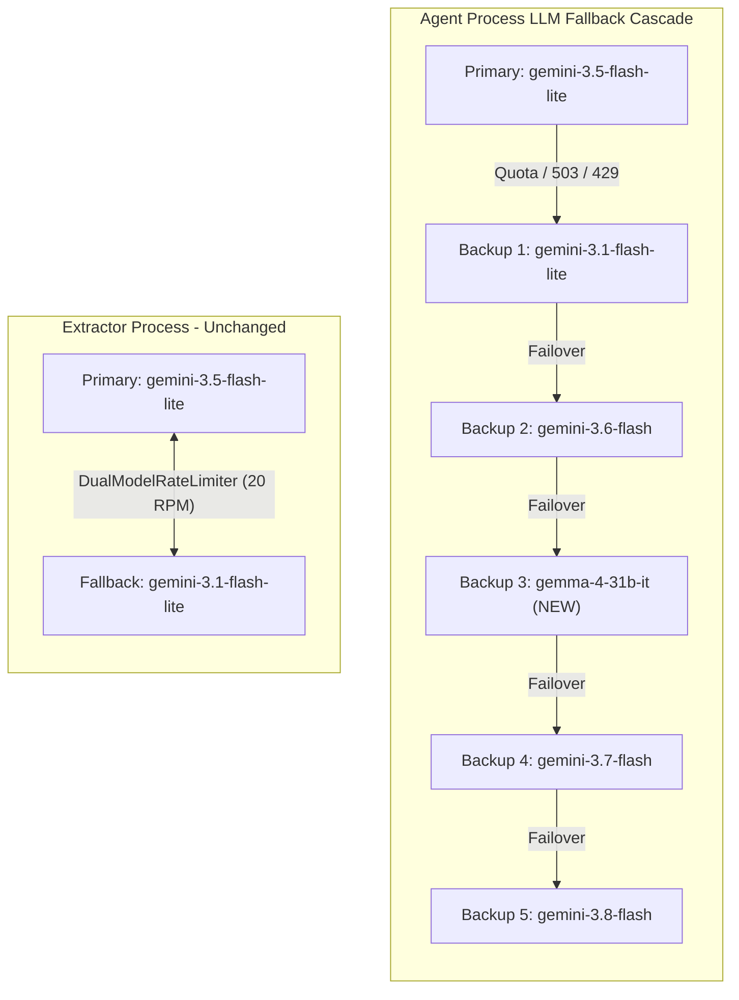

# Plan: Integrate Gemma 4 31B as Third Fallback Model for Agent Process

## Goal Description

Enable **Gemma 4 31B Instruct** (`gemma-4-31b-it`) as the **third backup (fallback) model** specifically within the agent analytical and conversational pipeline (`backend/app/agent/analytics/`). This enhances model resilience against API outages or quota exhaustion on the Gemini Flash series while keeping the multimodal PDF extractor (`backend/app/extractor/`) strictly isolated with its existing dual-model token bucket limiter.

---

## User Review Required

> [!NOTE]
> **Target Scope & Boundary Isolation:**
> Per the design requirement, Gemma 4 31B will **only** be added to the agent process (`AnalyticsSettings` candidate model cascade powering `ExpenseAnalyticsGraph` and `Supervisor`). The PDF extraction system (`backend/app/extractor/`) remains untouched and continues to operate on its dual-model rotation (`gemini-3.5-flash-lite` and `gemini-3.1-flash-lite`).

> [!IMPORTANT]
> **API & SDK Compatibility:**
> `gemma-4-31b-it` is natively supported in the unified `google-genai` SDK using the exact same API credentials (`GEMINI_API_KEY`) and supports structured JSON outputs (`response_mime_type="application/json"`, `response_schema`), temperature control, and system instructions identically to Gemini models.

---

## Open Questions

None. The requirements are clearly specified:
1. Target model: Gemma 4 31B (`gemma-4-31b-it`).
2. Position: 3rd backup model in the fallback cascade (after `gemini-3.1-flash-lite` and `gemini-3.6-flash`).
3. Process Scope: Restricted to the agent process only (analytics & conversational supervisor), excluding extractor.

---

## Proposed Changes



---

### Backend Configuration & Agent Nodes

#### [MODIFY] [backend/app/agent/analytics/config.py](file:///home/nereyes/agentes/data-analyst-ai-agent/backend/app/agent/analytics/config.py)
* Update `fallback_models` default factory to insert `"gemma-4-31b-it"` at index 2 (the 3rd backup position).
* Update field description to reflect inclusion of Gemma models alongside Gemini Flash models.

```python
<<<<
    fallback_models: list[str] = Field(
        default_factory=lambda: [
            "gemini-3.1-flash-lite",
            "gemini-3.6-flash",
            "gemini-3.7-flash",
            "gemini-3.8-flash",
        ],
        validation_alias="FALLBACK_MODELS",
        description="Ordered list of backup Gemini Flash models",
    )
====
    fallback_models: list[str] = Field(
        default_factory=lambda: [
            "gemini-3.1-flash-lite",
            "gemini-3.6-flash",
            "gemma-4-31b-it",
            "gemini-3.7-flash",
            "gemini-3.8-flash",
        ],
        validation_alias="FALLBACK_MODELS",
        description="Ordered list of backup Gemini Flash and Gemma models",
    )
>>>>
```

---

### Architecture & System Documentation

#### [MODIFY] [backend/docs/analytics_engine_architecture.md](file:///home/nereyes/agentes/data-analyst-ai-agent/backend/docs/analytics_engine_architecture.md)
* Update Section 6 (`Multi-Model Candidate Ladder`) to document the updated model hierarchy:
  1. Primary: `gemini-3.5-flash-lite` (or `GEMINI_MODEL` override)
  2. Fallback 1: `gemini-3.1-flash-lite`
  3. Fallback 2: `gemini-3.6-flash`
  4. Fallback 3: `gemma-4-31b-it` (Gemma 4 31B Instruct)
  5. Fallback 4: `gemini-3.7-flash`
  6. Fallback 5: `gemini-3.8-flash`

---

### Backend Test Suite

#### [MODIFY] [backend/tests/test_observability.py](file:///home/nereyes/agentes/data-analyst-ai-agent/backend/tests/test_observability.py)
* Add unit test `test_analytics_settings_candidate_models_includes_gemma4_backup`:
  * Validates that `AnalyticsSettings().fallback_models[2] == "gemma-4-31b-it"`.
  * Validates `get_candidate_models()` generates the expected deduplicated cascade with `gemma-4-31b-it` positioned third among the backup models.
  * Validates that setting `FALLBACK_MODEL` environment variable prepends properly without corrupting the cascade.
* Add unit test `test_generate_content_with_fallback_cascades_to_gemma4`:
  * Mocks primary and first two fallback failures (3 exceptions) and validates that the 4th attempt activates `gemma-4-31b-it` with successful response and telemetry logging.

---

## Verification Plan

### Automated Tests
Run the backend test suite and verify test execution and coverage enforcement (>=65%):

```bash
# 1. Run the targeted observability and candidate model tests
PYTHONPATH=backend pytest backend/tests/test_observability.py -v

# 2. Universal verification gate (enforces >=65% coverage)
PYTHONPATH=backend pytest backend/tests/ -v --cov=backend/app --cov-fail-under=65
```

### Manual Verification
* Inspect `AnalyticsSettings().get_candidate_models()` output in a Python session to confirm:
  ```python
  from backend.app.agent.analytics.config import AnalyticsSettings
  settings = AnalyticsSettings()
  print(settings.get_candidate_models())
  # Expected: ['gemini-3.5-flash-lite', 'gemini-3.1-flash-lite', 'gemini-3.6-flash', 'gemma-4-31b-it', 'gemini-3.7-flash', 'gemini-3.8-flash']
  ```
