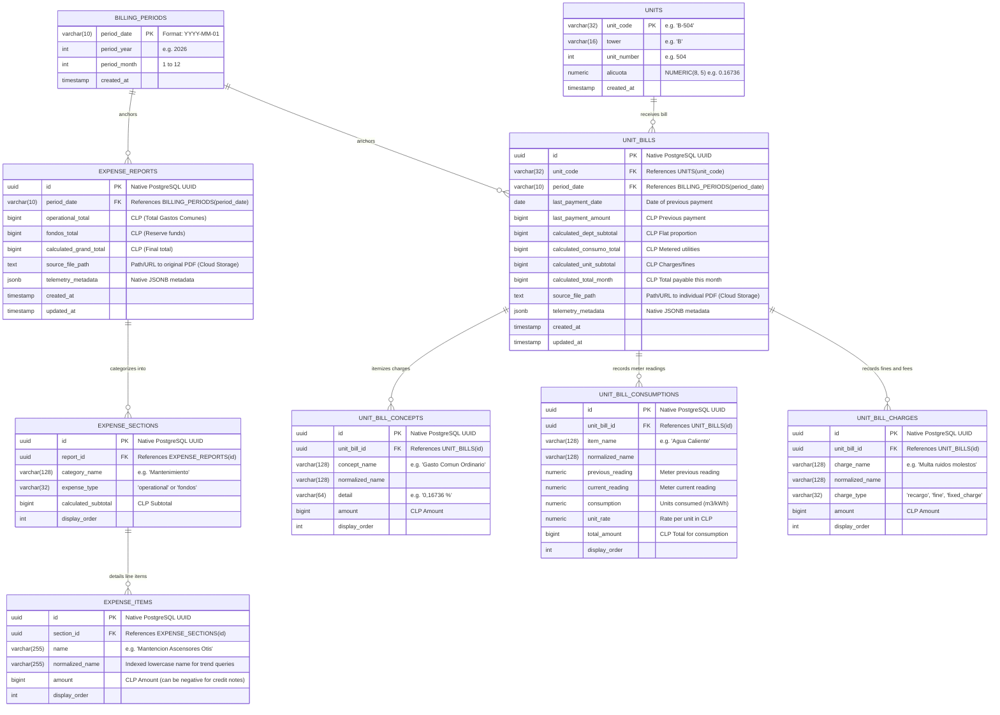

# Database Schema Architecture: Condominium Financial Management

## 1. Overview & Architectural Goals

This database stores and links two core financial domains for a 420-apartment condominium in Chile:
1. **Building-Level Expenses (*Gastos Comunes del Edificio*)**: Total monthly operational costs, reserve funds (*fondos de reserva*), vendor invoices, and line-item categorization.
2. **Flat-Level Expenses (*Notas de Cobro por Unidad*)**: Individual billing for each of the 420 apartments, proportional allocations based on each unit's official *alícuota* percentage, metered utility consumption (e.g. hot water), and unit-level charges or fines.

### Target Engine & Stack
- **Database Engine**: PostgreSQL 15+ (Google Cloud SQL)
- **ORM / Migrations**: SQLAlchemy 2.0 + Alembic (`backend/app/models.py`, `backend/alembic/`)
- **Currency**: Chilean Peso (CLP) stored strictly as **`BIGINT` / `INTEGER`** (no decimals) to guarantee 100% financial precision.
- **Percentages**: Stored as exact **`NUMERIC(8, 5)`** (e.g., `0.16736%`).
- **Telemetry / Metadata**: PostgreSQL native **`JSONB`** for rich querying.

---

## 2. Entity-Relationship Diagram (ERD)

---

## 3. Detailed Table Specifications

### 3.1. Dimension / Master Tables

#### `units` (The 420 apartments)
Represents the fixed physical apartments.
- **Columns**: `unit_code` (PK), `tower`, `unit_number`, `alicuota`, `created_at`
- **Constraints**:
  - `PRIMARY KEY (unit_code)` (e.g. `'B-504'`)
  - `UNIQUE (tower, unit_number)`
  - `CHECK (alicuota > 0)`

#### `billing_periods` (The time dimension)
Anchors monthly billing cycles cleanly.
- **Columns**: `period_date` (PK), `period_year`, `period_month`, `created_at`
- **Constraints**:
  - `PRIMARY KEY (period_date)` (format `'YYYY-MM-01'`)
  - `CHECK (period_month BETWEEN 1 AND 12)`

---

### 3.2. Building Expense Tables (Preserved 3-Tier Hierarchy)

#### `expense_reports`
The monthly general summary header for the condominium.
- `FOREIGN KEY (period_date) REFERENCES billing_periods(period_date) ON DELETE RESTRICT`.
- `UNIQUE (period_date)`: Only 1 building report per period.

#### `expense_sections`
Categorical grouping (Administration, Maintenance, Utilities, Reserve Funds).
- `FOREIGN KEY (report_id) REFERENCES expense_reports(id) ON DELETE CASCADE`.
- `UNIQUE (report_id, category_name)`.

#### `expense_items`
Individual line items and contractor invoices.
- `FOREIGN KEY (section_id) REFERENCES expense_sections(id) ON DELETE CASCADE`.
- `INDEX (normalized_name)` for historical vendor trend analysis.

---

### 3.3. Unit Billing Tables

#### `unit_bills`
The central monthly statement for an individual apartment (*Nota de Cobro*).
- `FOREIGN KEY (unit_code) REFERENCES units(unit_code) ON DELETE RESTRICT`.
- `FOREIGN KEY (period_date) REFERENCES billing_periods(period_date) ON DELETE RESTRICT`.
- `UNIQUE (unit_code, period_date)`: Guarantees no duplicate bills for the same unit in the same month.

#### `unit_bill_concepts`
Itemized prorated breakdown for the unit.
- `FOREIGN KEY (unit_bill_id) REFERENCES unit_bills(id) ON DELETE CASCADE`.

#### `unit_bill_consumptions`
Individual metered readings (e.g., hot water meters).
- `FOREIGN KEY (unit_bill_id) REFERENCES unit_bills(id) ON DELETE CASCADE`.

#### `unit_bill_charges`
Unit-specific fines, barbecue (quincho) fees, or late payment interest.
- `FOREIGN KEY (unit_bill_id) REFERENCES unit_bills(id) ON DELETE CASCADE`.
